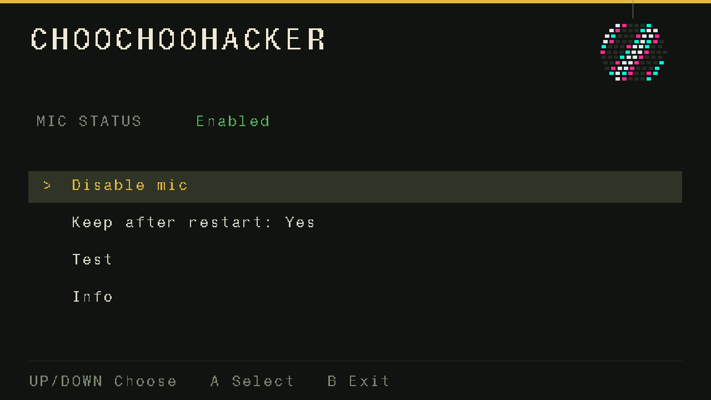
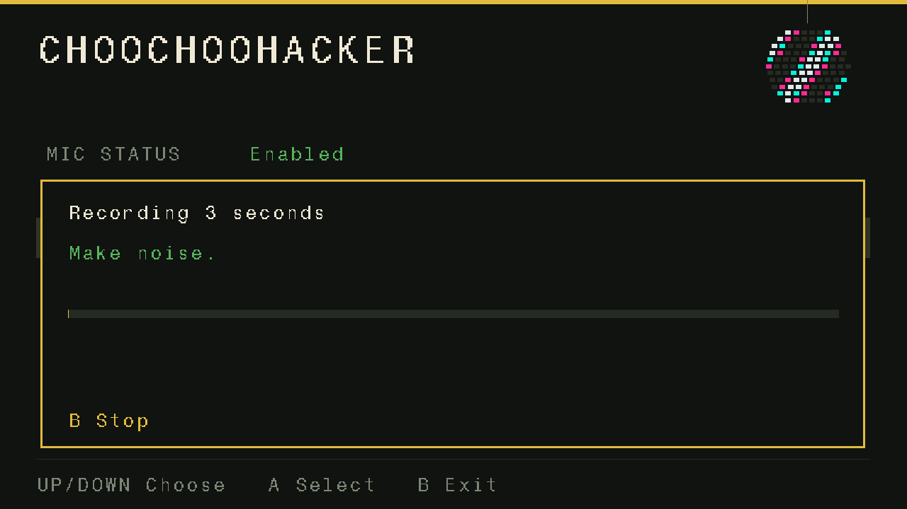
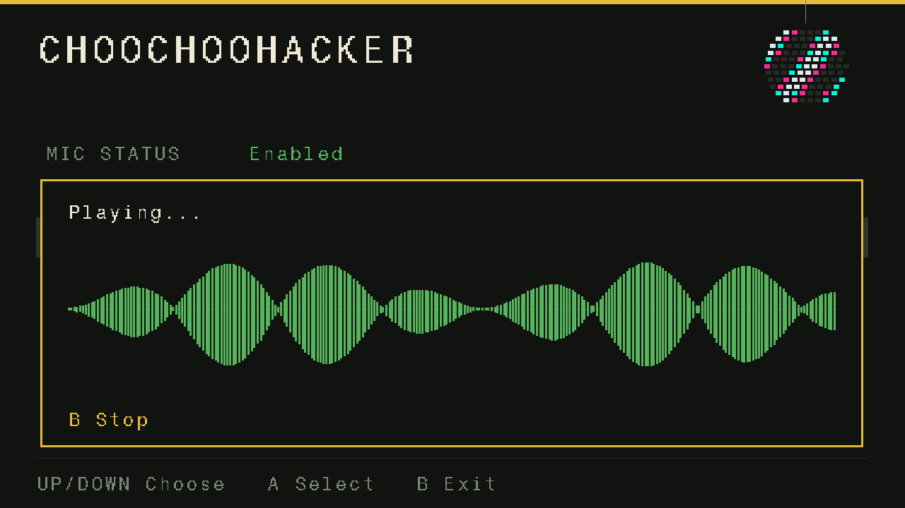
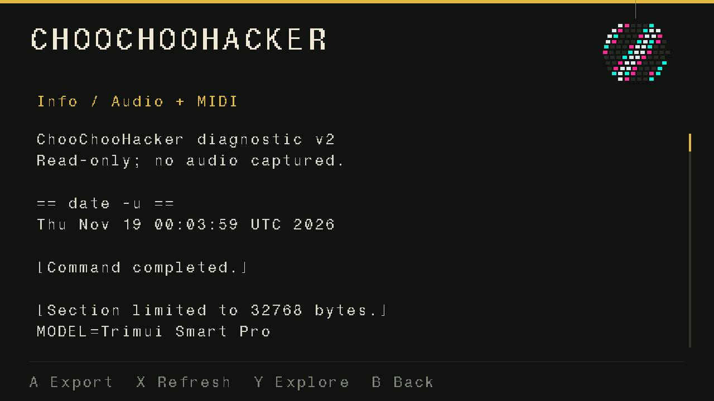

# ChooChooHacker

<div align="center">

**Your handheld's microphone controls. No terminal required.**

Enable it. Disable it. Keep your choice after a restart. Make some noise.

Dubwise colours, bitmap lettering and a neon disco ball.
Built for handheld buttons, not a desktop mouse.

[**Download the NextUI .pak**](https://github.com/paiheulevrai/ChooChooHacker/releases/latest)
&nbsp; | &nbsp;
[Report a problem / suggest a console](https://github.com/paiheulevrai/ChooChooHacker/issues)



</div>

> **Experimental, honestly.** Tested on Trimui Smart Pro with NextUI.
> A working audio stream is not proof of a physically connected onboard mic:
> the three-second sound test is there to help you check.

## What it does

| You want to... | Open... |
| --- | --- |
| Make the internal mic available to another app | **Enable mic** |
| Turn the internal MIC1 route off | **Disable mic** |
| Keep either choice after rebooting | **Keep after restart** |
| Check what the input actually hears | **Test** |
| Troubleshoot audio or MIDI | **Info**, then export a diagnostic |
| Investigate another audio input or console | **Info > Explore** |
| Control it from another application | The [public CLI](#cli-for-other-apps) |

No background recording, telemetry or network access. No tracker modification.
The normal screen stays small; the technical details stay in Info.

[Install](#install) | [First use](#first-use) | [Screenshots](#screenshots) |
[Compatibility](#compatibility) | [Troubleshooting](#troubleshooting) |
[CLI](#cli-for-other-apps) | [Build](#build-and-verification)

## Screenshots

| Three-second recording | Waveform and replay |
| --- | --- |
|  |  |



These are screenshots of the application's own renderer, not design mockups.
The main and Info screens were rendered on the Smart Pro test console.
The recording/playback screenshots use a **synthetic waveform fixture** and do
not demonstrate a successful acoustic recording. No recorded sound is published.

## Compatibility

| Console / environment | Current status |
| --- | --- |
| **Trimui Smart Pro / NextUI tg5040 / A133 / Linux 4.9.191** | Tested automatic MIC1 profile; capture/playback path and persistent activation verified on the test unit |
| RG353V | Planned testing; no automatic microphone profile yet |
| Other Linux handhelds | Diagnostics and explicit input exploration; no automatic mixer patch |
| PortMaster package | Experimental launcher/package; not hardware-tested |

The app does not add a microphone where none is wired, and a mixer control
named "MIC" does not establish that one exists. Automatic writes are deliberately
limited to the tested Smart Pro profile; unknown models are not guessed.

## Install

### NextUI / Trimui Smart Pro

1. Download **`ChooChooHacker.pak.zip`** from the
   [latest release](https://github.com/paiheulevrai/ChooChooHacker/releases/latest).
   Choose the release asset, not GitHub's "Source code" ZIP.
2. Extract it. You should get a folder named **`ChooChooHacker.pak`**.
3. Copy that entire folder to **`Tools/tg5040/`** on your SD card.
4. Safely eject the card, put it back in the console and open NextUI's
   **Tools > ChooChooHacker**.

The resulting layout is:

```text
SDCARD/
  Tools/
    tg5040/
      ChooChooHacker.pak/
        launch.sh
        choochoohacker.aarch64
        control.sh
        ...
```

Do not nest an extra `ChooChooHacker.pak` folder inside the first one.

### Updating or uninstalling

- **Update:** close the app first, replace its program files, and **keep the
  existing `state/` folder**. It contains the original mixer settings.
- **Uninstall or move:** if Keep after restart is Yes, switch it to No first.
  If you used temporary settings, restart the console once so its reset hook
  can finish. You can then remove/move the application folder.
- Never delete `state/` or the boot hook as a shortcut to undo changes.

The optional PortMaster download is for advanced testing; the NextUI `.pak`
is the documented installation path.

## First use

### Use the mic in another app

1. Open ChooChooHacker and check **MIC STATUS**.
2. Select **Enable mic**, press **A**, then confirm.
3. If you want it available after every reboot, set **Keep after restart: Yes**.
4. Exit with **B** or **Start**, then open your recording/music app.

The setting stays in place when ChooChooHacker closes. You do not need to leave
it running in the background. With persistence enabled, you also do not need
to reopen it after every restart.

### Check the sound

1. Set a low, comfortable speaker volume.
2. Choose **Test** and confirm recording **and** playback.
3. When the popup says **Make noise**, speak or tap near the suspected mic.
4. After three seconds, inspect the waveform and listen to automatic replay.
5. Press **A** to replay or **B** to close. B also stops a running test.

A waveform alone is not enough: try a recognizable sound and check that it
is present in the replay. The take stays in RAM only.

### Turn it off

Select **Disable mic** and confirm. If Keep after restart is Yes, **Disabled**
is remembered too. To stop applying the patch altogether, switch Keep after
restart to No; this restores the values from before your first change.

Disable controls the known internal MIC1 input route, not every USB input and
not a hardware privacy switch.

### Send a useful bug report

Open **Info**, press **A** to export, then copy the resulting text file from
the app's `diagnostics/` folder on the SD card. Review it and attach it to a
[GitHub issue](https://github.com/paiheulevrai/ChooChooHacker/issues), together
with your console/OS, actions tried and what you heard. Nothing is uploaded
automatically.

## Main screen

- **MIC STATUS:** Enabled, Disabled, Found/inactive, Not found or Unknown.
  This describes the known internal MIC1 route, not a physical recording test.
- **Enable / Disable mic:** choose the input state. Disable switches MIC1 boost
  off and gain to zero; it is not a hardware privacy switch for every audio input.
- **Keep after restart:** remember the chosen state, including **Disabled**.
- **Test:** confirm, make noise for three seconds, see the waveform and hear
  automatic replay at 25% digital level. Keep physical speaker volume low.
- **Info:** scroll the audio/MIDI diagnostic report, export it or open Explore.

Up/Down selects; physical A confirms; B cancels or goes back; Start exits.
On Info, Left/Right moves a page, A exports, X refreshes and Y opens Explore.
Keyboard: arrows, Enter, Escape, R refresh, D Explore, Q exit.

| Screen | Extra controls |
| --- | --- |
| Main | X refreshes the current mic settings |
| Info | Up/Down scroll, Left/Right page, A export, X refresh, Y Explore |
| Test popup | B stop/close; A replay after playback finishes |
| Input controls | Up/Down choose, Left/Right edit, A apply, X undo, B restore/back |

Test captures 48 kHz stereo S16 in RAM (about 576 KB), closes input before replay,
and never saves audio to disk. B stops; after replay, A replays and B closes.
The waveform is visually normalized: a visible trace may be noise or loopback.

## Temporary and persistent settings

The original boost, gain and both ADC values are saved **before the first write**.
Enabling uses boost on, gain 31, ADC 160,160; disabling uses boost off, gain 0,
leaving ADC levels unchanged. Speaker volume is never changed.

- **Keep after restart: No:** the setting survives closing the app, so another
  app can use it. At the next NextUI boot a one-shot hook restores the exact
  original values, then removes itself. CLI `restore` undoes it immediately.
- **Keep after restart: Yes:** a permanent SD-card hook reapplies the chosen
  **on or off** state on every NextUI boot. It does not self-delete.
- Switching Keep after restart off restores the original values and removes
  the app-owned hook. Do this before removing or moving the app.

Only `.userdata/tg5040/.hooks/boot.d/90-choochoohacker.sh` is installed.
Existing `auto.sh`, root filesystem and other tools' hooks are not changed.
Failed changes attempt rollback; failed restores retain recovery snapshots and
report an error. Do not edit the same controls in another app while patched.
Do not delete `state/` as a way to undo changes.

Enabling a route cannot fix another app's ALSA PCM-opening bug. ChooChooTracker's
Smart Pro capture failure is tracked in
[issue #205](https://github.com/paiheulevrai/Choochootracker/issues/205).
This utility tries SDL's named codec, raw `hw:CARD=audiocodec,DEV=0`, then
`plughw`. Raw PCM worked on the test console where sysdefault/plughw failed.

## Info and diagnostic export

The report includes model, OS/kernel/SoC, CPU, memory, temperature/power,
kernel modules, ALSA and SDL versions, capture settings and program hashes;
sound cards/drivers, mixer metadata and values, PCM descriptions and current
hardware/software parameters, USB audio formats, raw MIDI devices, sequencer
clients, ports/connections and queues; plus the latest discovery results.

Info and export are **read-only and do not open audio**. Hardware format
capabilities are collected only during explicitly confirmed Discovery.
Missing commands, busy devices and failed probes are reported, not guessed.
Reads are bounded (8 cards, 16 PCM devices/card, file sections 8 KB, command
sections 32 KB, per-command timeout 3 seconds). The screen shows up to 32 KB;
export contains the complete report within those per-section limits.

A on Info exports `diagnostics/diagnostic-YYYYMMDD-HHMMSS-PID.txt` beside the app.
No environment dump, network configuration, recordings, credentials or dedicated
serial-number files are collected. Serial fields in file sections are filtered.
**Review device/client names and the whole report before sharing.**
The app never submits an issue automatically. After copying and reviewing an
export on your PC, use GitHub's issue form or prepare one with:

```sh
gh issue create --repo paiheulevrai/ChooChooHacker --web \
  --title "Audio support: console / OS" --body-file reviewed-diagnostic.txt
```

Attach your observations (what was connected, actions tried, whether a sound
was actually heard). Submit only after checking the preview.

## Explore / advanced

**Discover inputs** enumerates up to eight named ALSA capture inputs and briefly
opens each, with no automatic mixer changes. If available, `arecord` also dumps
hardware capabilities while discarding its one-second capture to `/dev/null`.
An SDL probe checks the format used by Test. Results go to `discovery.log`;
the first usable input is selected for Test for this app session only.
B stops Discovery. Stream success is **not** acoustic mic identification.
On a supported Smart Pro, use Enable first if its input is disabled.

**Try input controls** is for manual experiments, including unknown consoles.
Only writable boolean, integer or enumerated input/mic/capture/ADC controls are
offered; output/playback/speaker controls are excluded. This is a conservative
name filter, not a certified hardware profile. Change one value with Left/Right
(one integer step); A confirms applying it to every channel of that control.
X restores all experiments. B restores them before returning.

Exact per-control snapshots are retained until restoration succeeds. Repeated
changes keep the first snapshot; at most 32 controls may be pending.
Normal app exit and launcher cleanup also restore experiments. They do not
become boot patches. **Do not unplug or restart during an experiment.** After a
crash, retry `experiment-restore` in the same boot with the same device attached.
If the card node or boot identity changed, restoration refuses to guess and
keeps snapshots for inspection; a crash/power loss is not guaranteed to undo
OS-saved mixer state. Boot hooks still apply the normal supported MIC1 setting
and warn about pending manual snapshots.

No modules are loaded, USB roles changed, arbitrary commands executed or gains
automatically swept. Unknown hardware is never enabled automatically.

## Troubleshooting

| What you see | What to try |
| --- | --- |
| **Not found** or **Unknown** | Open Info and refresh. Export a report; this is not an invitation to install random drivers. |
| **Found, inactive** | On the supported Smart Pro profile, choose Enable mic. |
| **Enabled**, but silence/noise | Run the three-second acoustic test. Routing enabled does not prove a physical mic exists. |
| Another app sees `audiocodec` but cannot arm it | That app may need to open the raw named PCM; see the linked tracker issue below. |
| Setting disappears after reboot | Check Keep after restart. No intentionally restores the original values at the next boot. |
| Persistence is Yes but reboot activation fails | Keep the app at its installed path; inspect/export diagnostics and `boot.log`. |
| Change/restore error | Keep the console/device connected and retain `state/`; export a report before changing anything else. |

**Does this fix ChooChooTracker automatically?** No. It makes a supported mixer
route available, but a client app still needs a working capture implementation.
The known Smart Pro PCM-opening failure is tracked in
[ChooChooTracker #205](https://github.com/paiheulevrai/Choochootracker/issues/205).

**Does temporary mean only while this app is open?** No: until the next reboot
or an explicit restore. **Does the persistent hook delete itself?** No: only
the temporary restoration hook is one-shot.

**Can I test another console?** Export Info first. Explore can probe capture
inputs and offers carefully limited manual input controls, but it does not
silently apply the Smart Pro patch to another model. Share your report and
observations; do not assume matching control names mean matching hardware.

## CLI for other apps

Commands locate `control.sh` next to the executable, independent of the caller's
working directory, and run without display/audio initialization:

```sh
APP=/mnt/SDCARD/Tools/tg5040/ChooChooHacker.pak/choochoohacker.aarch64
"$APP" status
"$APP" mic-on
"$APP" mic-off
"$APP" persist-on
"$APP" persist-off
"$APP" restore
"$APP" diagnostics
"$APP" export-log
"$APP" inputs
"$APP" discover
"$APP" controls
"$APP" experiment-set audiocodec 2 7
"$APP" experiment-restore
```

Do not copy the example control number blindly: use `controls` first.
`status` prints `KEY=VALUE` lines including `MIC_STATE=on|off|inactive|unavailable`,
`PERSIST=enabled|disabled` (or an explicit error), `BASELINE` and `TEMPORARY`.
`export-log` prints `REPORT=absolute-path`. `inputs` prints named PCMs.
`controls` prints `CONTROL_N=CARD|NUMID|NAME|TYPE|MIN|MAX|CHANNELS|VALUES`.
Experiment values are exact ALSA CSV (boolean `on/off`, integer/enum numeric).
Values must match the channel count and metadata bounds.

Exit codes: 0 success, 1 backend/probe failure, 2 invalid command/arguments,
124 outer time limit, 127 backend launcher unavailable. Errors are explicit on
stderr; mixer/tool details can also appear on stdout. Calling a mutating or
capture command is the caller's explicit confirmation: there is no CLI dialog.
Callers must obtain their own user consent and handle failures.

`--probe-input` or `--probe-device hw:CARD=ID,DEV=N` opens capture for one second
without saving or playing audio. `--runtime-info` lists compiled audio support
without opening devices. `cleanup`, `boot` and `reset-temp` are internal script
actions, not public binary commands. `CHH_ROOT` is only for isolated tests.

## Build and verification

Developers need an ARM64 C++17 cross-compiler (`aarch64-linux-gnu-g++`),
native and ARM64 SDL2 development files, `pkg-config`, Make, Python 3 and Zip.
The current build uses WSL Ubuntu. No ChooChooTracker engine/assets are required.

```sh
make test all
make package
unzip -t releases/ChooChooHacker.pak.zip
unzip -t releases/choochoohacker-portmaster.zip
```

Tests cover fake mixer rollback/restoration, temporary and persistent on/off,
CLI from an unrelated directory without a display, diagnostic export, discovery,
input experiment validation/recovery, SDL dummy record/replay and exact
three-second stopping, waveform bounds and offscreen navigation.

`--self-test` checks navigation without hardware writes/capture.
`--smoke-test /tmp/chh` renders main, Info and synthetic popup BMPs, reading
diagnostics without capturing. These checks do not replace physical-button or
acoustic testing. Runtime output goes to `ChooChooHacker.log`, hooks to `boot.log`.

## Contributing and support

Console support reports are especially welcome. Include the exact model and OS,
a reviewed diagnostic export, connected audio/MIDI devices, and a clear account
of whether an identifiable acoustic sound was successfully recorded/replayed.
Please remove anything personal from device/client names before posting.

For code changes, preserve the small main-screen workflow, named-device selection,
explicit capture consent, original-value snapshots and restoration on failure.
Unknown hardware should stay diagnostic/manual until a profile is verified.

## Credits and license

Inspired by and built alongside
[ChooChooTracker](https://github.com/paiheulevrai/Choochootracker), including its
Dubwise palette. The bitmap font is from its FragmentMono atlas. Audio setup,
normalized stereo peak/release logic, controller mapping and launcher structure
are adapted from ChooChooTracker. Its MIT notice is preserved in `LICENSE` and
both packages. See [LICENSE](LICENSE). No tracker engine is linked.

The original local `usb hack` drafts are not executed, packaged or published:
they target other hardware/kernels and are unrelated to this microphone utility.
